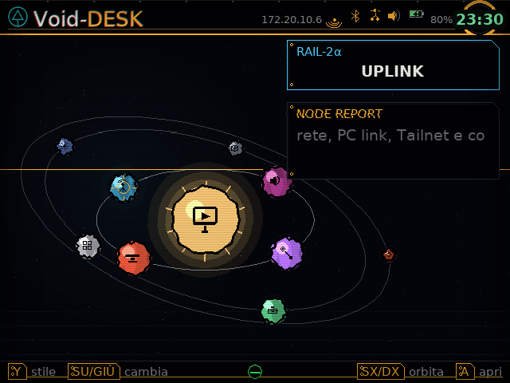
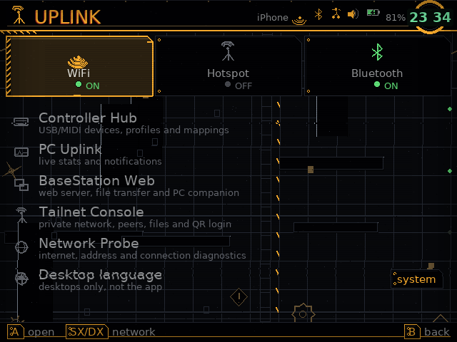

<div align="center">

<pre>
╔════════════════════════════════════════════════════════════════════╗
║                                                                    ║
║   ██████╗ ██╗    ██╗ █████╗ ███████╗ █████╗ ██████╗                ║
║  ██╔═══██╗██║    ██║██╔══██╗██╔════╝██╔══██╗██╔══██╗               ║
║  ██║   ██║██║ █╗ ██║███████║███████╗███████║██████╔╝               ║
║  ██║▄▄ ██║██║███╗██║██╔══██║╚════██║██╔══██║██╔══██╗               ║
║  ╚██████╔╝╚███╔███╔╝██║  ██║███████║██║  ██║██║  ██║               ║
║   ╚══▀▀═╝  ╚══╝╚══╝ ╚═╝  ╚═╝╚══════╝╚═╝  ╚═╝╚═╝  ╚═╝               ║
║                           // DESK                                  ║
╚════════════════════════════════════════════════════════════════════╝
</pre>

# QWASAR DESK

**A symbiotic Linux handheld environment.**

*BORN IN THE VOID. BUILT BEYOND THE FIRMWARE.*

[](https://github.com/SilverCrow2323/Void-Desk-Project/actions/workflows/ci.yml)
[](https://github.com/SilverCrow2323/Void-Desk-Project/releases)

**Formerly Void Desk / VoidDesk · SPDW Factory**

</div>

QWASAR Desk is the evolving identity of Void Desk: a controller-first environment that grows around Linux handheld firmware. It brings system tools, connectivity, media, diagnostics, desktop sessions and a configurable visual shell into one navigable experience.

The long-term direction is a **Symbiotic Layer**. QWASAR should use the host firmware's supported application, service, storage and theme extension points, then progressively provide a richer experience without making the original firmware unbootable or difficult to recover. It is not a replacement firmware image today.

> **Brand transition:** QWASAR Desk is the new product name. The repository slug, installed package root (`Void-Desk/`), launcher names and existing configuration paths remain unchanged for compatibility. A coordinated package/identifier migration will be a separate, reversible change.

## At a glance

| | |
|---|---|
| Product identity | **QWASAR Desk** (formerly Void Desk) |
| Development line | **10.5.4-NEXUS** release candidate |
| Latest published handheld package | **v10.2.0** (2026-08-11); v10.5.4 is not yet a published release |
| Primary target | Anbernic RG35XX-H / compatible Allwinner H700 handhelds |
| Current firmware target | MustardOS / muOS 2606.0 Andromeda |
| Main frontend | Python + Pygame framebuffer UI |
| Experimental frontend | LÖVE 2D; incomplete and not feature-equivalent to Pygame |
| PC entry point | `voiddesk.py` |
| Handheld entry point | `mux_launch.sh` |
| User configuration | `data/desk_config.json` |
| Optional desktop | XFCE in a separate Ubuntu image |
| License | No root-level LICENSE file is currently declared |

Compatibility is evidence-based. muOS Andromeda on compatible H700 devices is the current packaging target. KNULLI, ROCKNIX and custom firmware are strategic targets, not blanket compatibility claims; each needs a platform adapter and hardware validation.

## NEXUS — the current home interface

NEXUS is an animated, orbit-based hub selector designed for D-pad and controller navigation.



### Hubs and workspaces

| Hub | Workspace | Purpose |
|---|---|---|
| **START SESSION** | Configure | Start or repair the optional desktop |
| **THE FORGE** | Maintain | Components, packages, updates and CLI tools |
| **UPLINK** | Connect | Wi-Fi, hotspot, Bluetooth, Tailscale, PC Uplink, BaseStation and controllers |
| **MEDIA VAULT** | Media | Radio, IPTV, media library and audio tools |
| **WORKSHOP** | Maintain | Device checks, diagnostics, storage, monitor, logs and maintenance |
| **RT:TOOLBOX** | Create | Calculator, clock, calendar, notes, file manager, terminal and utilities |
| **MUOS APPS / GAMES** | Play | Handheld app discovery, PortMaster hand-off and game tools |
| **SETTINGS** | Configure | Visuals, language, fonts, controller bindings and status indicators |
| **INFO / COMMUNITY** | Discover | Manuals, project information and community links |
| **OUTERDESK** | Extend | Standalone applications and optional integrations |
| **END SESSION** | Configure | Exit, restart, reboot and power-off flows |

The source-grounded inventory and proposed categories are in [docs/TOOL_CATALOG.md](docs/TOOL_CATALOG.md) and `data/tool_catalog.json`. Availability depends on firmware, hardware, dependencies, permissions and frontend implementation; a menu entry alone is not proof that a tool is usable.

## Visual identity — the Megastructure

QWASAR's signature direction is raw industrial science fiction: monumental architecture, steel, deep blacks, manga-like ink contrast, technical markings and restrained signal colours. The mood may evoke dark architectural cyberpunk manga, but all QWASAR artwork, symbols and layouts must be original.

The visual system separates **style** (composition, typography, geometry, texture and motion) from **palette** (colour tokens). Proposed styles:

- **Megastructure** — brutalist, monumental, steel and signal red/cyan.
- **Manga Ink** — high-contrast monochrome, paper, ink and restrained vermilion.
- **Industrial** — riveted panels, measurement marks and hazard accents.
- **Terminal** — phosphor, monospace and low-motion information density.
- **Neon Noir** — layered night-city contrast, used sparingly.
- **Minimal** — quiet surfaces, clear hierarchy and reduced effects.

Pygame contains the main industrial visual language and several home styles. LÖVE has its own palette system; full visual parity is still in development. See [docs/VISUAL_IDENTITY.md](docs/VISUAL_IDENTITY.md).





## Runtime architecture

- **Pygame:** reference frontend in `desk/`; entry point `desk/main.py`.
- **LÖVE:** experimental frontend in `love/`; entry point `love/main.lua`.
- **Local service:** `service/voiddesk_service.py` provides the bridge for host status, jobs and selected device actions.
- **Device launcher:** `mux_launch.sh` uses the muOS application lifecycle, launches the local service and selects the frontend.
- **PC launcher:** `voiddesk.py` provides development and desktop launch modes.
- **Standalone tools:** `outdesk/` and `external/tools.json` describe optional applications and integrations.

The local service is a privileged boundary and must remain local by default. Future Studio sync must be device-initiated and authenticated; it must not expose the existing host-control service to the internet.

See [docs/ARCHITECTURE.md](docs/ARCHITECTURE.md) for execution flow.

## The Symbiotic Layer roadmap

QWASAR's goal is deeper integration with muOS, not an unsafe firmware takeover:

1. **Application layer:** use the official muOS application runner and lifecycle, including its storage and foreground-process handling.
2. **Service layer:** manage QWASAR-owned services with explicit startup, health checks, permissions and clean shutdown.
3. **Shared capability layer:** expose device, network, storage and media capabilities to Pygame, LÖVE and future frontends through typed APIs.
4. **Experience layer:** optional QWASAR navigation, profiles, artwork, themes and dashboards, while preserving return to the native muOS frontend.
5. **Studio and ecosystem:** browser companion, profile editor, official plugin catalog and platform adapters for KNULLI, ROCKNIX and custom systems after validation.
6. **Deeper integration:** only through documented, reversible extension points with backup, rollback and a recovery path.

The muOS developer documentation describes its app runner, launcher metadata, setup helpers, storage paths and extension mechanisms. QWASAR will use those interfaces rather than patching boot internals or replacing system files. See [Application Runner](https://community.muos.dev/t/application-runner/1282), [Extending MustardOS](https://muos.dev/docs/infrastructure/extending) and [Frontend and Launching](https://muos.dev/docs/infrastructure/launching).

**Non-negotiable:** muOS must remain bootable and recoverable if QWASAR is disabled, uninstalled or fails to start. No bootloader replacement, destructive init changes or irreversible system modifications are part of this roadmap.

## QWASAR Studio — browser companion

Studio is planned as an opt-in web/PWA companion. It will let users edit menu layouts, labels, profiles and visual choices, then import/export or sync profiles with a device. Initial sharing is limited to profiles and official plugins; third-party plugin publishing is out of scope for v1.

The profile/plugin schemas and trust boundaries are being developed under `schemas/`. Cloud API and device pairing are planned components, not deployed services.

## Installation on muOS

The latest published package remains `VoidDesk_v10.2.0.muxapp` (release v10.2.0, published 2026-08-11). The v10.5.4-NEXUS source line is a release candidate and has not yet been published as an installable package.

1. Download the latest published **.muxapp** asset from [GitHub Releases](https://github.com/SilverCrow2323/Void-Desk-Project/releases). Do not use the source ZIP as an installer.
2. Copy the package to SD1 `ARCHIVE/`.
3. On the handheld, open **Applications → Archive Manager** and install it.
4. Launch the app from Applications and follow the on-screen setup flow.

The installed root remains `Void-Desk/` during this branding transition.

### First-run guidance

- Back up saves and personal configuration before installing test builds or changing firmware.
- Keep the device powered during package or optional desktop-image installation.
- Verify available storage before installing the optional XFCE image.
- Keep Wi-Fi and valid TLS certificates available for dependency/bootstrap downloads.
- Preserve logs if setup fails before retrying storage-intensive operations.

**Pygame is the recommended daily-use frontend.** LÖVE is included for development and testing only; several actions and routes remain incomplete.

## Build QWASAR / Void Desk packages

The **Build Void Desk** workflow is being introduced as the package pipeline for the QWASAR transition. Once the build-workflow change is merged, start it from GitHub Actions and select:

- `all` — build both targets.
- `muos` — build and validate the muOS `.muxapp`.
- `pc` — build the Linux PC bundle.

Outputs include SHA-256 checksums. Workflow artifacts are retained for 30 days. The current PC output is a portable Linux source bundle, not an AppImage or statically linked executable; its first launch creates a Python virtual environment and installs Pygame/psutil.

See [packaging/pc/README.md](packaging/pc/README.md). Installed package and release identifiers remain Void Desk until a separate migration is ready.

## Web browsers on muOS

QWASAR's optional desktop browsers run inside the **XFCE environment**. NetSurf (`netsurf-gtk`), Falkon (`falkon`) and Dillo (`dillo`) are package choices for the separate Ubuntu desktop image; they are not browser binaries installed directly into the muOS host.

To use one:

1. Install and start the optional XFCE desktop from **START SESSION**.
2. Open **THE FORGE → BROWSER / RETE** and install the browser into the desktop image.
3. Launch it from the XFCE application menu or an XFCE terminal.

The separate `qtWebBrowser` entry in EthoStore is a third-party muOS application. It is not the same component as the XFCE browsers above and is not bundled or maintained by QWASAR.

### Browser launch errors

An `Input/output error` is not specific enough to identify one cause. Record which browser was selected, whether it was launched from XFCE or from the muOS application grid, and the complete error text. Useful logs are:

- `data/xfce_session.log` — XFCE session output.
- `data/session_xfce.log` — X/desktop startup output.
- `data/voiddesk.log` — QWASAR launcher and session hand-off output.

Installing a browser inside the XFCE image does not make it executable from the muOS host; those are separate environments.

## Run on a Linux PC

Prerequisites: Linux, Python 3.10+, a graphical session and a terminal. The first Pygame launch creates `.venv_desktop` and installs Pygame and psutil. The LÖVE frontend requires a system LÖVE installation.

~~~bash
git clone --recurse-submodules https://github.com/SilverCrow2323/Void-Desk-Project.git
cd Void-Desk-Project

python3 voiddesk.py
python3 voiddesk.py --py
python3 voiddesk.py --love
python3 voiddesk.py --engine py
python3 voiddesk.py --engine love
python3 voiddesk.py --repair
python3 voiddesk.py --help
~~~

Initialize submodules before package builds if you did not clone recursively:

~~~bash
git submodule update --init --recursive
python3 tools/build_muxapp.py
~~~

## Controls

| Input | Default action |
|---|---|
| D-pad | Navigate |
| A | Confirm / open |
| B | Back / cancel |
| X / Y | Context or secondary action |
| L1 / R1 | Change tab or category |
| START / SELECT | Panel-specific action |

The active screen footer remains the source of truth for panel-specific shortcuts.

## Configuration and generated data

| Path | Role |
|---|---|
| `data/desk_config.json` | Main user configuration |
| `data/iptv_config.json` | IPTV configuration |
| `data/voiddesk.log` | Device launcher and session log |
| `data/logs/` | Additional runtime logs |
| `data/visual-captures/` | Local screenshots and JSON metadata |
| `runtime/` | Downloaded Pygame runtime |
| `data/xfce.img` | Optional desktop image |

Back up personal configuration and media/list files before reinstalling. Generated runtime files and logs are excluded from version control.

## Repository map

```text
.
├── .github/workflows/   # Continuous integration and package builds
├── assets/              # Fonts, sounds, glyphs and platform assets
├── bin/                 # Bootstrap, diagnostics and session scripts
├── data/                # Configuration and local runtime state
├── desk/                # Python/Pygame application and hubs
├── lib/                 # Runtime libraries and framebuffer helpers
├── love/                # LÖVE frontend, scenes, widgets and themes
├── outdesk/             # Standalone applications and integrations
├── resources/           # Artwork and screenshots
├── service/             # Local backend service
├── tests/               # Focused automated tests
├── tools/               # Visual asset and screenshot inventory tools
├── wiki-source/         # Source pages for the GitHub Wiki
├── voidcast_addons/     # VoidCast add-ons
├── mux_launch.sh        # muOS device entry point
└── voiddesk.py          # Legacy PC/development launcher
```

## Development and quality checks

~~~bash
python3 -m venv .venv
. .venv/bin/activate
python -m pip install --upgrade pip
python -m pip install pytest ruff

python -m compileall -q BUILDCHECK.py voiddesk.py bin desk service outdesk voidcast_addons assets
pytest -q
python BUILDCHECK.py
~~~

CI also checks LuaJIT syntax, shell parsing and visual captures. A green CI run does not replace tests on the target handheld. See [docs/DEVELOPMENT.md](docs/DEVELOPMENT.md).

## Troubleshooting

| Symptom | First checks |
|---|---|
| Black screen or immediate exit | `data/voiddesk.log`, engine choice, framebuffer permissions, free storage |
| Pygame engine fails | Device clock, CA certificates and bootstrap logs; do not disable TLS verification |
| LÖVE missing on PC | Install the PC build of LÖVE and retry `python3 voiddesk.py --love` |
| Desktop session does not start | `data/voiddesk.log`, desktop-image readiness, free storage |
| A hub reports a missing tool | Install the optional dependency, then re-run diagnostics |
| Controls stop responding | Return to the parent panel, reconnect the controller, inspect diagnostics |
| Update or repair fails | Preserve logs and open an issue with device/firmware details |

Bug reports should include version, device, firmware, selected engine, reproduction steps and a short relevant log excerpt. Redact usernames, network names, IP addresses, tokens and private data.

### Device power-off

When QWASAR Desk is started as a muOS application, the power-off action returns control to `mux_launch.sh`. The launcher stops the local companion service, syncs pending filesystem writes, then requests a forced power-off, with kernel power-off fallbacks if the first command returns. This is separate from **END SESSION → Close**, which only exits QWASAR Desk.

If the device does not power off, preserve `data/voiddesk.log` and report the device model, muOS build and whether the screen/LED state changed. Avoid repeated hard resets while storage writes may still be in progress.

## Security and responsible use

QWASAR can interact with host utilities, install packages, manage network interfaces, mount an optional desktop image and start local services.

- Review package and system operations before confirming them.
- Use network tools only on devices and networks you own or are authorized to administer.
- Do not expose local services to untrusted networks.
- Treat imported profiles, archives, playlists and add-ons as untrusted data.
- Keep credentials, host identifiers and private files out of profile exports and screenshots.
- Preserve a working muOS recovery path; never make the host firmware depend on QWASAR starting successfully.

See [SECURITY.md](SECURITY.md) and [CONTRIBUTING.md](CONTRIBUTING.md).

## Credits and licensing

QWASAR Desk is the evolving product identity of Void Desk, maintained by **Sir Pips / SPDW Factory**. The repository acknowledges Pygame, LÖVE, MustardOS/muOS, Debian/Ubuntu and upstream projects listed in [THIRD-PARTY.md](THIRD-PARTY.md).

There is currently no root-level LICENSE file. Do not assume a specific open-source license until the corresponding license text is published.

<div align="center">

**QWASAR DESK // THE SYMBIOTIC LAYER**

*The void is not empty. It is infrastructure.*

[Releases](https://github.com/SilverCrow2323/Void-Desk-Project/releases) · [Issues](https://github.com/SilverCrow2323/Void-Desk-Project/issues) · [Source](https://github.com/SilverCrow2323/Void-Desk-Project)

</div>
