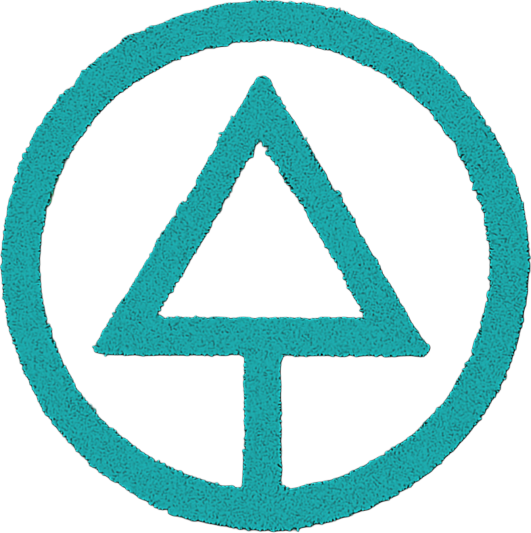
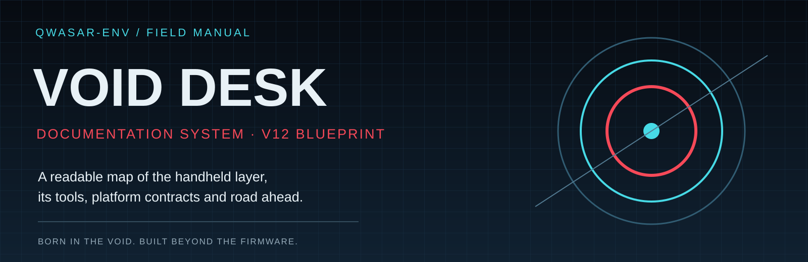
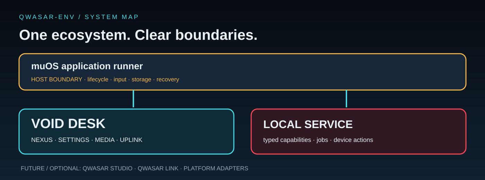
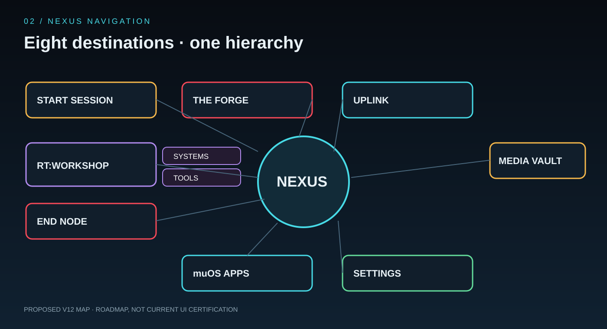
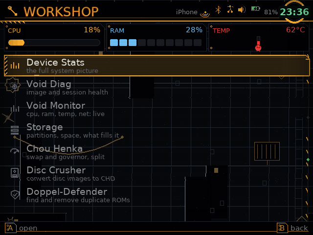
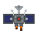
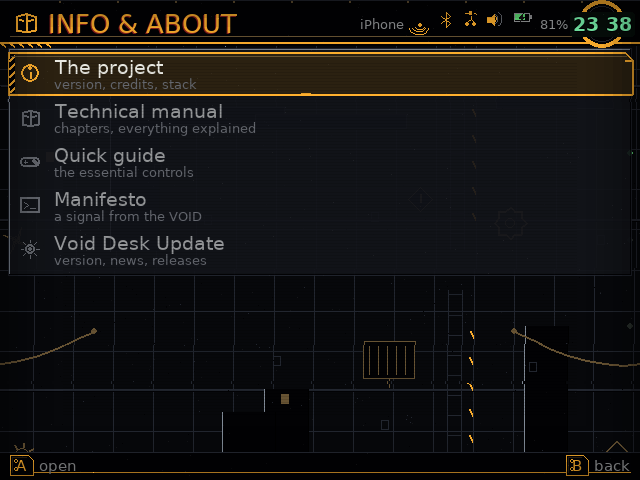
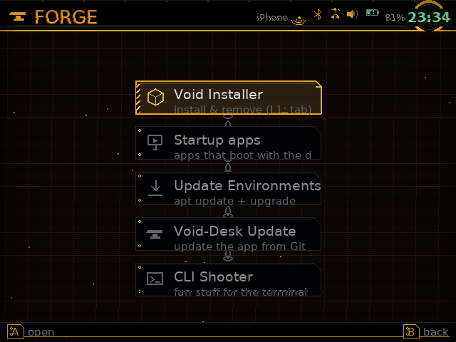
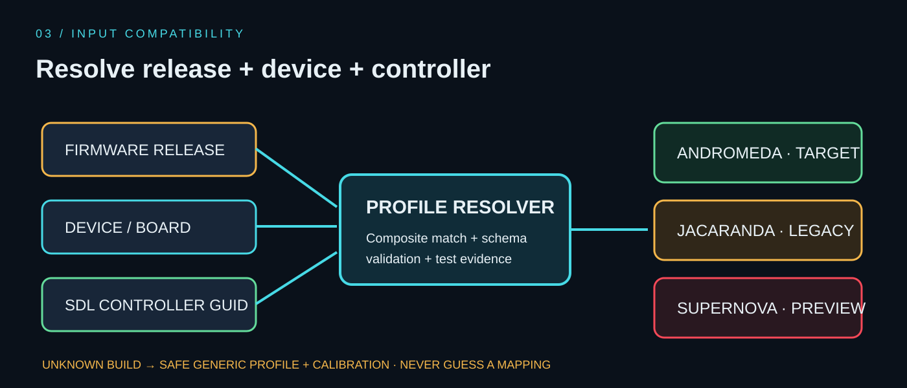

  
  <h1>VOID DESK</h1>
  
<strong>A symbiotic Linux handheld environment.</strong>

  
<em>BORN IN THE VOID. BUILT BEYOND THE FIRMWARE.</em>

  
  

    
    
    
  

<!-- # VOID DESK: keep the legacy project heading discoverable to repository tooling. -->

Void Desk is a controller-first handheld environment in the wider **QWASAR-Env** ecosystem. It brings navigation, system tools, connectivity, media, diagnostics and optional desktop sessions into one interface while keeping the host firmware's native boot and recovery paths intact. The **Symbiotic Layer** is the architectural direction: integrate with the host firmware through supported interfaces while keeping boot, recovery and uninstall paths reversible.

> [!IMPORTANT]
> **This repository contains active development, not a v12 release.** The latest published handheld package is **v10.2.0** (11 August 2026). The v10.5.4-NEXUS development line remains under review; [PR #66](https://github.com/SilverCrow2323/Void-Desk-Project/pull/66) is a draft. **v12 is a product and architecture blueprint**, not an installable package.

> [!NOTE]
> **Current implementation:** Pygame is the reference handheld frontend. LÖVE is experimental and is not feature-equivalent. muOS 2606.0 Andromeda is the current packaging target; compatibility with another firmware/device pair needs its own validation.

## 🧭 Start here

| I want to… | Go to |
|---|---|
| Understand the project | [Documentation home](docs/README.md) |
| Install the latest published package | [Installation guide](wiki-source/Installation-muOS-Andromeda.md) · [Releases](https://github.com/SilverCrow2323/Void-Desk-Project/releases) |
| Explore the v12 direction | [v12 blueprint](docs/V12_BLUEPRINT.md) |
| Check firmware and controller compatibility | [muOS compatibility matrix](docs/MUOS_FIRMWARE_COMPATIBILITY.md) |
| Understand runtime and source layout | [Architecture](docs/ARCHITECTURE.md) |
| Develop or contribute | [Development guide](docs/DEVELOPMENT.md) · [Contributing](CONTRIBUTING.md) |
| Open the GitHub Wiki | [Wiki home](https://github.com/SilverCrow2323/Void-Desk-Project/wiki) · [source pages](wiki-source/README.md) |

## 🌌 One ecosystem, clear boundaries

Void Desk is the handheld client. **QWASAR-Env** is the broader ecosystem of shared contracts and future companion products; these are different layers, not different firmware distributions.

| Layer | Responsibility | Reality today |
|---|---|---|
| **Void Desk** | NEXUS interface, handheld tools, frontend engines and lifecycle | Current product |
| **muOS host adapter** | Application runner, device paths, storage, input and clean exit | Current target: 2606.0 Andromeda / validated H700 combinations |
| **Local service** | Typed bridge for system status, jobs, network and selected host actions | Present; ownership and API coverage are being consolidated |
| **QWASAR-Env contracts** | UI composition, profiles, capabilities and module metadata | Partially implemented; frontend adoption differs |
| **QWASAR Studio / Link** | Browser workbench and PC companion | Roadmap concepts; not released services |

**QWASAR Studio direction:** the intended Studio experience is **one web app** bringing Module Forge, Layout Designer, Release Composer and Community Library together. This is a roadmap description, not a claim that Studio is already released. APT package recipes target only the optional Debian/Ubuntu desktop image; the muOS handheld package does not run APT or install Debian desktop packages on the host firmware.

## 🪐 NEXUS — the v12 direction

The v12 blueprint proposes eight destinations grouped by user intent. **RT:WORKSHOP** combines the old Workshop and Toolbox responsibilities into two satellites: **SYSTEMS** and **TOOLS**. **UPLINK** owns connectivity, remote access and synchronisation. **SETTINGS** becomes the control cockpit for appearance, input, device/OS, identity and QWASAR configuration.

## 🧩 Navigation icon library

The following PNG files in `resources/` are **menu and hub icons**, not screenshots of application screens. They are the visual identity assets used to represent Void Desk destinations.

| WORKSHOP | SETTINGS | THE FORGE | START SESSION | RT:TOOLBOX |
|---|---|---|---|---|
|  |  |  |  |  |

| NETSPHERE / UPLINK | muOS APPS | MEDIA VAULT | INFO | END |
|---|---|---|---|---|
|  |  |  |  |  |

These are existing project assets. The NEXUS v12 diagram above is a **proposed navigation map**, not a screenshot.

🖥️ Actual screen reference — THE FORGE

This is a screenshot of the **THE FORGE screen**, not an icon:

The separate `resources/the_forge.png` file shown in the navigation icon grid above is the **THE FORGE hub icon**.

## 🧩 Runtime and frontends

| Component | Path | Role |
|---|---|---|
| Handheld launcher | <code>mux_launch.sh</code> | muOS application lifecycle and frontend launch |
| Pygame | <code>desk/</code> | Reference handheld UI |
| LÖVE | <code>love/</code> | Experimental frontend; parity is incomplete |
| Local service | <code>service/voiddesk_service.py</code> | Background bridge for selected host capabilities and jobs |
| UI contracts | <code>data/qwasar_ui_manifest.json</code>, <code>schemas/</code> | Declarative interface and validation |
| Profile resolver | <code>tools/qwasar_profile_resolver.py</code> | Validates profiles and writes an effective snapshot |

> [!WARNING]
> Profiles are declarative configuration, not executable plugins. The module-system documents define a contribution/trust contract; they do **not** mean arbitrary third-party executable modules are safe or fully supported.

## 🎮 muOS and controller profiles

A button map can depend on firmware release, handheld model, SDL controller GUID and firmware input behaviour. The v12 design resolves **release + device + controller**, then maps physical inputs to semantic actions such as <code>CONFIRM</code>, <code>BACK</code>, <code>START</code> and <code>QUICK_PANEL</code>.

| Firmware line | Status reviewed 12 Nov 2026 | Policy |
|---|---|---|
| **2606.0 Andromeda** | Current muOS release listed by the project | Main packaging target; validate exact device/GUID profile |
| **2601.0 Jacaranda** | Archived | Explicit legacy profile family |
| **2601.1 Funky Jacaranda** | Archived variant | Separate metadata until equivalence is proven |
| **2612 Supernova** | In development; not a stable release | Preview only; never auto-certify a mapping |
| Other / unknown builds | Varies | Safe generic fallback + manual calibration |

See [muOS firmware compatibility](docs/MUOS_FIRMWARE_COMPATIBILITY.md). Release discovery is informational: a new release must never silently replace the active input map.

## 📦 Install on muOS

Download the **.muxapp release asset** from [GitHub Releases](https://github.com/SilverCrow2323/Void-Desk-Project/releases); do not use the source-code ZIP as an installer.

1. Copy the package to <code>SD1/ARCHIVE/</code>.
2. On the handheld, open **Applications → Archive Manager** and install it.
3. Launch Void Desk from Applications.

The installed application root remains <code>Void-Desk/</code> for compatibility. Do not rename it manually.

## 🛠️ Run on Linux

Prerequisites: Linux, Python 3.10+, a graphical session and terminal. The desktop launcher may create <code>.venv_desktop</code> on first launch.

~~~bash
git clone --recurse-submodules https://github.com/SilverCrow2323/Void-Desk-Project.git
cd Void-Desk-Project
python3 voiddesk.py
~~~

Useful options:

~~~bash
python3 voiddesk.py --py
python3 voiddesk.py --love
python3 voiddesk.py --engine py
python3 voiddesk.py --engine love
python3 voiddesk.py --repair
python3 voiddesk.py --help
~~~

## 📚 Documentation library

| Guide | What you will find |
|---|---|
| [Documentation home](docs/README.md) | Reading paths and complete topic index |
| [v12 blueprint](docs/V12_BLUEPRINT.md) | Product structure, Uplink, Workshop, Settings, services and acceptance gates |
| [muOS compatibility](docs/MUOS_FIRMWARE_COMPATIBILITY.md) | Firmware matrix, device detection and controller mapping |
| [Architecture](docs/ARCHITECTURE.md) | Launch flow, services, frontends and source ownership |
| [Tool catalog](docs/TOOL_CATALOG.md) | Source-grounded feature inventory |
| [Visual identity](docs/VISUAL_IDENTITY.md) | Product UI style, palettes and accessibility |
| [Documentation style guide](docs/DOCUMENTATION_STYLE_GUIDE.md) | Callouts, diagrams, images and expandable content |
| [Development guide](docs/DEVELOPMENT.md) | Build, tests, screenshots and hardware validation |
| [Visual capture workflow](docs/visual/README.md) | PNG capture, asset inventory and privacy review |
| [Security policy](SECURITY.md) | Security reporting and safe-operation boundaries |

The [Wiki source](wiki-source/README.md) is version-controlled. The live GitHub Wiki needs its first **Home** page created once before the publisher can push the remaining pages and diagrams.

## 🧪 Testing and release evidence

~~~bash
python -m compileall -q BUILDCHECK.py voiddesk.py bin desk service outdesk voidcast_addons assets
pytest -q
python BUILDCHECK.py
~~~

A passing CI run is not physical handheld certification. A release claim must identify the device and firmware tested and cover startup, controller input, the changed feature, failure states, clean exit and return to muOS.

## 🛡️ Safety principles

- Keep the native muOS frontend and recovery path available.
- Do not replace the host bootloader or patch protected firmware binaries.
- Keep local host-control services within a trusted local boundary.
- Never place passwords, API keys, pairing tokens or private identifiers in exported profiles or screenshots.
- Treat archives, playlists, profiles and add-ons as untrusted input.
- Make deeper integration reversible, backed up and removable.

  <strong>QWASAR DESK // THE SYMBIOTIC LAYER</strong> 
  <em>The void is not empty. It is infrastructure.</em>

