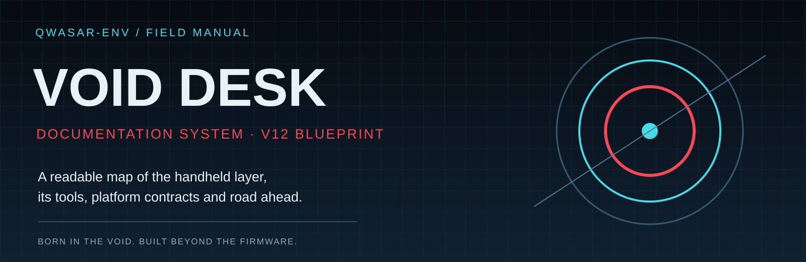

# 🎨 Documentation style guide

The manual should feel like a guided field interface, not a grey dump of engineering notes. Keep the QWASAR identity, but make legibility and navigation the priority.

## Page anatomy

1. A clear title and one-line purpose.
2. A visual overview when it improves understanding.
3. A concise status or important callout.
4. Descriptive sections and short paragraphs.
5. Tables for comparisons, states and reference data.
6. Expandable sections for advanced/optional details.
7. Related links and a clear next step.

## Reusable GitHub callouts

> [!NOTE]
> Background context or a useful detail.

> [!TIP]
> A practical shortcut or recommendation.

> [!IMPORTANT]
> A required step or compatibility constraint.

> [!WARNING]
> A risk that must be understood before proceeding.

> [!CAUTION]
> A destructive or potentially irreversible action.

## Expandable sections

Advanced options — keep the main narrative readable

Move long logs, exhaustive command output, optional troubleshooting and secondary implementation notes here. The page should still make sense when this section is closed.

## Images and diagrams

- Prefer editable **SVG** for architecture maps, navigation layouts and signal flows.
- Use **PNG** for actual product screenshots, logos and raster artwork.
- Every informative image needs meaningful alt text.
- Captions must distinguish current UI, historical UI and concept art.
- Keep high contrast and readable labels at narrow/mobile widths.
- Colour must never be the only way to communicate status.
- Review screenshots for SSIDs, IPs, tokens, hostnames, usernames and personal filenames.

## Diagrams

Use Mermaid for editable flow diagrams; use SVG when a composed graphic gives better hierarchy.

~~~mermaid
flowchart LR
  A[muOS host] --> B[Void Desk]
  B --> C[Frontend adapter]
  B --> D[Local capability service]
  D --> E[Device actions]
~~~

## Status vocabulary

| Mark | Meaning |
|---|---|
| ✅ Implemented | Present and verified at the stated level |
| 🧩 Partial | Some paths work; named gaps remain |
| 🧪 Experimental | Exists, but is not release-certified |
| 🗺️ Planned | Design/roadmap only; not shipped |
| ⚠️ Hardware pending | CI/desktop evidence exists; target device still needs testing |

## Editorial checklist

- [ ] Current implementation is separate from roadmap.
- [ ] Tables compare data; they do not hold long paragraphs.
- [ ] Callouts are reserved for important information.
- [ ] Long secondary content is collapsible.
- [ ] Images have useful alt text and render at mobile width.
- [ ] PNG captures have passed a privacy review.
- [ ] SVG diagrams retain editable source.
- [ ] Relative links resolve in repository and Wiki contexts.
- [ ] README, technical pages and Wiki source tell the same story.
