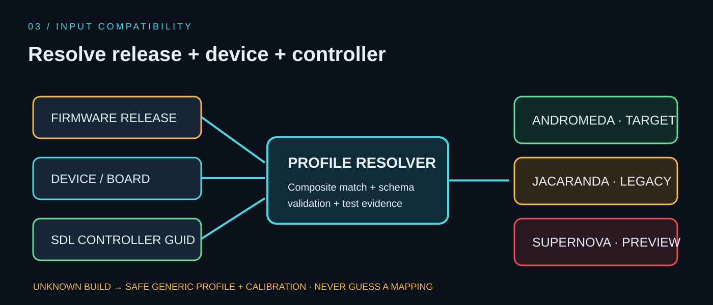

# 🎮 muOS firmware and controller compatibility

> [!NOTE]
> Compatibility is resolved from **firmware release + handheld model + controller identity**. “H700” alone is not a sufficiently precise input profile.

## Release matrix

| Firmware | Official status reviewed 12 Nov 2026 | Void Desk policy |
|---|---|---|
| **2606.0 Andromeda** | Current release listed by muOS | Main packaging target; validate exact device/GUID profile |
| **2601.0 Jacaranda** | Archived release | Explicit legacy profile; do not assume Andromeda equivalence |
| **2601.1 Funky Jacaranda** | Archived variant | Separate metadata until equivalence is proven |
| **2612 Supernova** | In development; not a stable release | Preview only; no certified mapping yet |
| Other / unknown | Varies | Safe generic fallback and manual calibration |

Official sources: [muOS releases](https://muos.dev/release) · [release progress](https://muos.dev/release/progress) · [extending muOS](https://muos.dev/docs/infrastructure/extending).

## Detection sequence

~~~mermaid
flowchart TD
  A[Start Void Desk] --> B[Detect OS and release]
  B --> C[Detect device / board]
  C --> D[Read SDL controller name and GUID]
  D --> E{Exact profile found?}
  E -->|Yes| F[Load versioned profile]
  E -->|No| G[Safe generic mapping]
  F --> H[Translate to semantic actions]
  G --> I[Offer calibration]
  H --> J[Input self-test]
  I --> J
  J --> K[Show profile source and confidence]
~~~

The detector should combine verified firmware markers, kernel/device-tree information, system metadata and SDL identity. It reports source and confidence for every field. Do not document an unverified marker path as a guaranteed API.

## Semantic action layer

The UI consumes stable actions such as <code>CONFIRM</code>, <code>BACK</code>, <code>START</code>, <code>QUICK_PANEL</code>, <code>MEDIA_PANEL</code>, <code>VOLUME_UP</code> and <code>VOLUME_DOWN</code>. Version/device profiles translate raw SDL or evdev events into these actions.

| State | Meaning | Behaviour |
|---|---|---|
| Validated | Exact release + device + controller was tested | Normal profile status with evidence |
| Candidate | Profile appears relevant, but test evidence is missing | Warn; allow calibration, do not claim certified |
| Generic fallback | No exact profile found | Safe baseline and calibration wizard |
| User override | User selected/edited mapping | Clearly show override and provide reset/export |

## Safety and rollback

- A newly detected release never silently overwrites the active mapping.
- Save profile edits atomically and retain the last working version.
- Keep a recovery action reachable without relying on the custom map.
- Profile data stays declarative and cannot execute scripts.
- Record firmware, device, controller name/GUID, profile ID and test outcome; redact personal identifiers.

## Release monitoring

A watcher may query official release metadata over TLS on a rate-limited schedule and cache the last successful result for offline use. It is informational only: no firmware downloads, no remote code execution and no silent profile activation.
