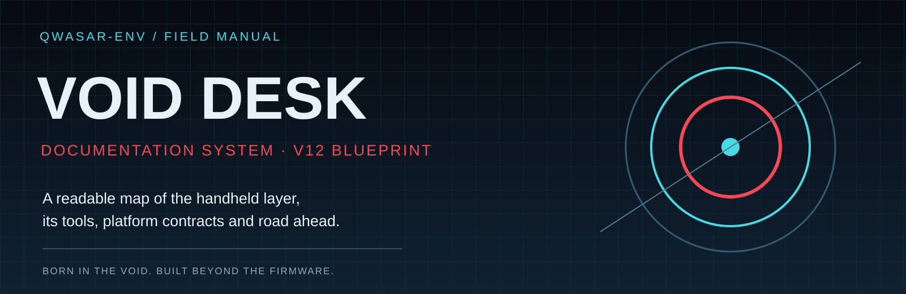
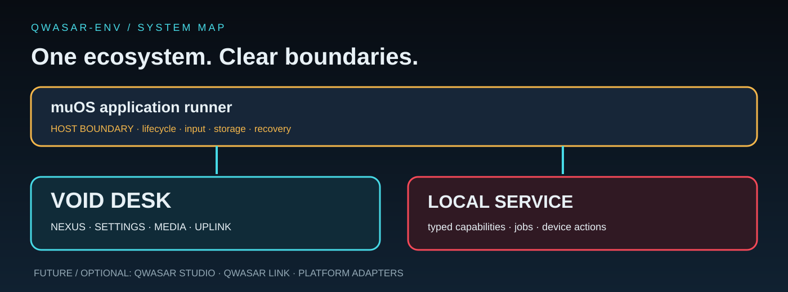

# 📚 Void Desk / QWASAR-Env documentation

A field manual for the handheld product, its host integration, the QWASAR contracts and the v12 direction.

> **Visual documentation portal:** browse the [QWASAR Field Portal](../site/index.html) for the designed, responsive guide experience, then open the [interactive Asset Atlas](../site/asset-atlas.html) to inspect the NEXUS icons and real THE FORGE screen capture, or explore the [QWASAR Studio local concept](../site/studio.html) for layout composition and data-only profile export. Press **Ctrl+K / ⌘K** from any page to open quick navigation. The Markdown files here remain the technical source of truth. The GitHub Wiki is optional; the portal does not depend on it.

> [!IMPORTANT]
> **Read implementation status honestly.** Pygame is the reference handheld frontend, LÖVE is experimental, and v12 is a blueprint—not a published package.

## Choose your path

| Role / goal | Start here | Next |
|---|---|---|
| New user | [Install on muOS](../wiki-source/Installation-muOS-Andromeda.md) | [Controls](../wiki-source/Controls-and-navigation.md) |
| Project overview | [README](../README.md) | [System architecture](assets/qwasar-system-map.svg) |
| Product direction | [v12 blueprint](V12_BLUEPRINT.md) | [NEXUS map](assets/nexus-v12-navigation.svg) |
| Device compatibility | [muOS matrix](MUOS_FIRMWARE_COMPATIBILITY.md) | [Profile resolver](QWASAR_PROFILE_RESOLVER.md) |
| Developer | [Development guide](DEVELOPMENT.md) | [Architecture](ARCHITECTURE.md) |
| Designer / writer | [Documentation style](DOCUMENTATION_STYLE_GUIDE.md) | [Visual identity](VISUAL_IDENTITY.md) |
| QA / release | [Visual capture workflow](visual/README.md) | [Release testing](../wiki-source/Release-testing.md) |

## 🗺️ The system at a glance

## Documentation map

### Product and experience
- [Void Desk v12 blueprint](V12_BLUEPRINT.md) — destination map, RT:WORKSHOP satellites, UPLINK, Settings and identity.
- [Product ecosystem map](PRODUCT_ECOSYSTEM_MAP.md) — product boundaries, names and platform responsibilities.
- [Tool catalog](TOOL_CATALOG.md) — source-grounded inventory and ownership.
- [Visual identity](VISUAL_IDENTITY.md) — product visual language, palettes, motion and accessibility.

### Platform and runtime
- [muOS firmware compatibility](MUOS_FIRMWARE_COMPATIBILITY.md) — release/device detection and controller profile policy.
- [Architecture](ARCHITECTURE.md) — current runtime, services and frontend boundaries.
- [QWASAR GUI system](QWASAR_GUI_SYSTEM.md) — engine-neutral composition contract.
- [Profile resolver](QWASAR_PROFILE_RESOLVER.md) — validation and effective snapshots.
- [Boot and session model](QWASAR_BOOT_AND_SESSION_MODEL.md) — launch selector and session hand-off.
- [Symbiotic layer](SYMBIOTIC_LAYER.md) — reversible integration with the host firmware.

### Engineering and trust
- [Development and quality](DEVELOPMENT.md)
- [Module system](MODULE_SYSTEM.md)
- [QWASAR Inspector](QWASAR_INSPECTOR.md)
- [QWASAR Switchboard](QWASAR_SWITCHBOARD.md)
- [Studio architecture](STUDIO_ARCHITECTURE.md)
- [Security policy](../SECURITY.md)
- [Third-party notices](../THIRD-PARTY.md)

### Visual QA and collaboration
- [Documentation style guide](DOCUMENTATION_STYLE_GUIDE.md)
- [Visual capture and asset workflow](visual/README.md)
- [Wiki source and publishing](../wiki-source/README.md)
- [Contributing](../CONTRIBUTING.md)
- [Issue triage](ISSUE_TRIAGE.md)

## Status language

| Status | Meaning |
|---|---|
| ✅ Implemented | Code exists in the stated branch and path has been verified at the described level |
| 🧩 Partial | Some paths work; the stated gaps remain |
| 🧪 Experimental | Present but not release-certified or feature-equivalent |
| 🗺️ Planned | Design/roadmap only; not shipped |
| ⚠️ Hardware pending | Desktop/CI checks exist; target hardware validation remains |

> [!TIP]
> The diagram is the fast overview. When a decision depends on exact behaviour, follow the linked technical contract.

🧭 Documentation maintenance rules

1. Update README, technical guide and Wiki source together when public behaviour changes.
2. Mark planned/partial features in the page itself.
3. Prefer relative links in the repository; Wiki assets are copied by the publisher.
4. Keep diagrams as editable SVG and use PNG for screenshots/raster artwork.
5. Review images for private network/device information before publication.
6. CI screenshots are not proof of physical compatibility.

