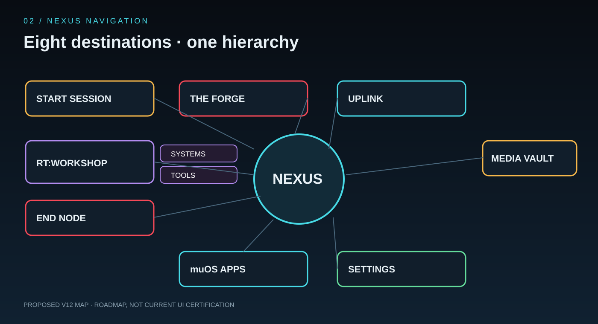

# Void Desk Tool Catalog and Module Information Architecture

This is an inventory of tool families and entry points found in the current source tree, paired with the proposed v12 workspace model below. It is a source-grounded map, not a promise that every item is enabled on every firmware or PC. Availability depends on host packages, device capabilities, permissions, optional downloads and frontend coverage. The future module system will turn these into declared contributions that users can compose into Void Desk workspaces. See [Void Desk Modules](MODULE_SYSTEM.md) for the module manifest, contribution slots, trust and package-flavour contract.

## Navigation model

Use three levels:

1. **Workspace** — the user's intent (Connect, Create, Maintain, Play, Media, Configure).
2. **Category** — a stable group of related tools.
3. **Tool** — one action or screen with a stable ID, capability requirements, platform support and lifecycle status.

Keep the existing NEXUS hubs as the visual top-level navigation for compatibility. The catalog can reorganize tools without renaming their internal routes. User-created profiles may reorder, relabel, hide, group and enable/disable registered contributions, but cannot create arbitrary executable routes or install code. Modules declare which contribution slots they fill.

## v12 target workspace/category model

> [!IMPORTANT]
> This table defines the **proposed v12 information architecture**, not a claim that every destination or workflow is already implemented. The current source still contains legacy routes such as WORKSHOP and RT:TOOLBOX. Keep those routes compatible during migration; do not rename code paths just to match a label.

| Destination | Section / satellite | Responsibility | Representative tools |
|---|---|---|---|
| START SESSION | Environments | Start, repair and return from standalone sessions | XFCE, IceWM, LXDE, terminal sessions |
| THE FORGE | Build & Packages | Install/update/remove approved applications and build packages | APT in optional desktop image, Void Desk builds, runtimes |
| THE FORGE | Modules & Profiles | Inspect compatible contributions and compose approved profiles | Module registry, profile validation, package flavours |
| UPLINK | Network Intelligence | Diagnose interfaces, routes, DNS, throughput and connectivity | Network Probe, Wi-Fi, hotspot, Bluetooth |
| UPLINK | Remote & Sync | Manage remote access, synchronisation and device pairing | Tailscale, Syncthing, PC companion, BaseStation, FTP |
| MEDIA VAULT | Playback & Library | Browse and play local/online media | Audio/video, radio, IPTV, playlists, recordings |
| RT:WORKSHOP | SYSTEMS | Device health and maintenance | Device diagnostics, monitor, storage, logs, backups, safe cleanup |
| RT:WORKSHOP | TOOLS | Everyday and technical utilities | PTY shell, isolated Python runner, calculator, clock, calendar, file tools |
| SETTINGS | General & Appearance | Personalise the interface | Language, themes, palette, typography, motion and display |
| SETTINGS | Controls & Device | Configure hardware-aware behaviour | Controller profiles, calibration, detected device and firmware |
| SETTINGS | Connectivity & Identity | Manage identity and trusted connections | BaseStation pairing, local Device ID, user profile |
| SETTINGS | QWASAR & Documentation | Inspect ecosystem settings and read the manual | QWASAR status, docs, credits and About |
| MUOS APPS | Application catalogue | Discover and hand off to installed native muOS apps | App discovery and validated launch hand-off |
| END NODE | Exit & Recovery | Leave the app safely and return control to firmware | Close, restart, reboot and power-off flows |

The two RT:WORKSHOP satellites are deliberately distinct: **SYSTEMS** owns the health of the device; **TOOLS** owns utilities used by the user. UPLINK owns network diagnostics and network-facing services. SETTINGS owns configuration and documentation, so INFO/ABOUT does not need to remain a separate primary NEXUS destination.

The v12 proposal does not change install ownership: **THE FORGE remains the only owner of install/update/uninstall operations**. A profile can hide or disable a contribution, but it does not delete its files or grant permissions. Current Pygame/LÖVE routes may continue to expose parts of the legacy IA until migration is complete.

## QWASAR management tools

- **QWASAR Inspector** validates the installed Void Desk structure: schema and manifest validity, duplicate/orphan IDs, unresolved routes/actions/providers, missing assets, dependency graph, engine/platform compatibility, permissions, package manifests and profile consistency. It is read-only by default and exports a report.
- **QWASAR Switchboard** enables/disables, hides/shows, pins and reorders workspaces, sections, modules, widgets, menu entries and global panels. It previews changes, checks dependencies and can revert to the last valid profile.

## Inventory by source area

### Core frontend tools

- `desk/hubs/`: Python/Pygame hub action classes for Toolbox, Workshop, Uplink, Media, Forge, Settings, Develop, Games, Community, OuterDesk and muOS Apps.
- `love/scenes/`: LÖVE scenes including Forge/APT, Calendar, Diagnostics, Display FX, External Tools, IPTV, muOS Apps, Media, Monitor, Session, Settings, Shell, Syncthing, Tailscale, Toolbox, Uplink, Workshop, Calculator, Clock and Editor.
- `love/core/`: shared scene manager, input, jobs, notifications, widgets, layout, bridge, shell client and status-facing modules.

### External application registry

`external/tools.json` is the current external tool registry (version 3). It currently declares:
- `voidcast`: standalone IPTV/media application, Python frontend, MEDIA category.
- `bgm_normalizer`: BGM normalization utility, shell launcher, MEDIA category.
- `file_gd_x`: File-GD X file manager, LÖVE launcher, TOOLBOX category.

The registry is the best starting point for a future unified catalog, but it currently describes launch metadata only. It does not yet express permissions, compatibility, dependencies, update channel, health, publisher trust or lifecycle status.

### Standalone applications under outdesk/

Source inventory includes BootAnimManager, Disc Crusher, EthoStore, ImageViewer, Little Mischief, MediaPlayer, Portable Forger and VoidCast. These should be separate catalog entries with explicit install source and compatibility metadata, not automatically treated as built-in Void Desk features.

**Security review flag:** Little Mischief contains Wi-Fi capture/scanning and attack-oriented scripts. Keep it isolated from the core catalog until its intended authorized-lab use, safeguards, permissions and packaging policy have been reviewed. Do not expose attack actions as ordinary connectivity utilities.

## Lifecycle and availability labels

Use consistent status labels in the catalog:
- `built_in`: shipped in the Void Desk package.
- `optional_dependency`: requires a host package or runtime.
- `external_app`: separately launched application.
- `experimental`: incomplete or not feature-equivalent across engines.
- `hidden`: available behind an optional navigation profile, not a security boundary.
- `unsupported_platform`: known platform mismatch.
- `deprecated`: retained for migration only.

A tool record should eventually include: stable ID, display name, short description, workspace, category, frontend route(s), launch kind, supported engines, supported platforms, required capabilities, dependencies, permissions, status, source/package, maintainer, and documentation URL.

## Consolidation rules

- One canonical tool ID regardless of engine; Pygame and LÖVE routes are adapters.
- Avoid duplicate entries for the same operation (e.g. system status exposed in both Toolbox and Workshop): one canonical tool with multiple navigation placements where useful.
- Separate read-only diagnostics from mutating maintenance actions.
- Group privileged actions (package install/remove, shell, reboot, mount, network configuration) under clear permission and confirmation boundaries.
- Keep optional desktop-image tools distinct from the handheld host environment.
- Never infer availability from a menu entry alone; use a capability/dependency probe and display an explicit unavailable reason.

## Optimization backlog

1. Preserve the existing Pygame non-blocking status poller pattern; no slow host command belongs in a render/input callback.
2. Make LÖVE configuration writes atomic and retain the previous valid file on failure.
3. Consolidate duplicate status refresh timers where the same service snapshot can be shared.
4. Make scene/tool metadata declarative so catalog, navigation and Studio can share one source.
5. Add lazy loading and cache invalidation rules for optional tool metadata/assets.
6. Add performance instrumentation for scene load, frame time, bridge queue depth and status refresh duration before speculative micro-optimizations.
