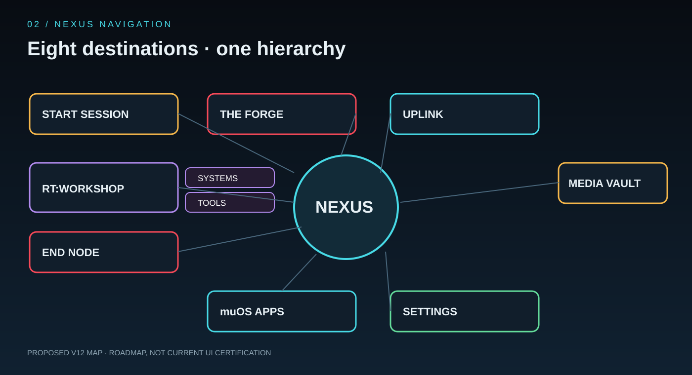
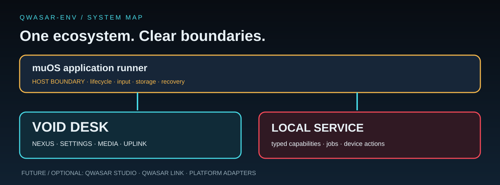
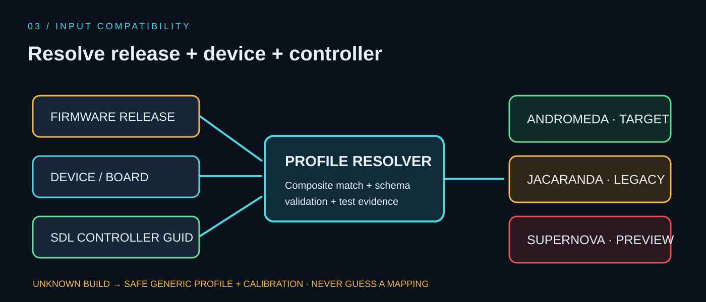

# 🪐 Void Desk v12 — product and architecture blueprint

> [!IMPORTANT]
> This is the target design, not a description of the current package. The current reference frontend is Pygame; LÖVE remains experimental. A v12 release needs hardware and lifecycle qualification.

## 1. Product structure

Void Desk is the handheld client in QWASAR-Env. muOS remains the host firmware and owns its native boot, application lifecycle and recovery. QWASAR contracts connect frontend adapters and shared services without turning the host firmware into a disposable layer.

## 2. NEXUS: eight destinations

| Destination | Intent | Ownership |
|---|---|---|
| START SESSION | Start an independent environment | Session lifecycle and hand-off |
| THE FORGE | Build and maintain software | Package/build/install/update/remove |
| UPLINK | Connect devices and diagnose networks | Network Probe, BaseStation, Tailscale, Syncthing, FTP |
| MEDIA VAULT | Browse and play media | Library, playback, playlists and streams |
| RT:WORKSHOP | Maintain the system and use utilities | Two satellites: SYSTEMS and TOOLS |
| SETTINGS | Configure the device and QWASAR | General, appearance, controls, device, identity, privacy and docs |
| MUOS APPS | Discover native handheld apps | Validated muOS launch hand-off |
| END NODE | Exit and recover | Close, restart, reboot and power-off |

### RT:WORKSHOP satellites

🛰️ SYSTEMS — device health and maintenance

- Device/OS diagnostics and hardware inventory
- CPU, temperature, memory and storage telemetry
- Logs and support bundles
- Backup/restore and safe cleanup/repair
- Explicit confirmation for destructive operations

🛰️ TOOLS — user and developer utilities

- RT:Shell as a PTY utility; XFCE is not a prerequisite for a host shell
- Python executor in a child process with timeouts, cancellation and bounded output
- Calculator, clock, calendar, notes and file utilities
- QWASAR Inspector and Switchboard when their implementations are connected to the UI

## 3. UPLINK — one network operations room

UPLINK groups Wi-Fi, hotspot, Bluetooth, PC Uplink, BaseStation, Tailscale, Syncthing, FTP and Network Probe. It owns network diagnostics and network-facing integrations.

- **BaseStation:** one screen, two separate status channels—the PC companion connection and the local file bridge. A local bridge process running is not evidence that a PC client is connected.
- **Network Probe:** scrollable report with Overview, Interfaces, Routing, DNS, Performance, Tailnet and Services. Every value carries a timestamp and provenance; unknown values remain unknown.
- **Syncthing:** dedicated themed screen using the existing host service. Do not start a duplicate daemon.
- **Tailscale:** one canonical capability/service API shared by frontend adapters.
- **Global operation panel:** queued/running/completed/failed/cancelled state, current phase, real progress or indeterminate state, expandable logs and safe retry/cancel actions.

## 4. Settings as a QWASAR cockpit

| Section | Owns |
|---|---|
| Overview | Device summary, service health and quick actions |
| General | Language, startup and interaction defaults |
| Appearance | Style, palette, text scale, layout and reduced motion |
| Controls & Input | Detected controller, semantic maps, calibration |
| Display & Performance | Resolution, frame pacing, low-power profile and effects |
| Connectivity | Network shortcuts and service state |
| Identity | Username/avatar, stable local Device ID, pairing status |
| Device & OS | Firmware/model detection and compatibility confidence |
| QWASAR | Profiles, UI composition, module inventory and diagnostics |
| Privacy & Security | Permissions, pairing, redaction and revocation |
| Advanced | Logs, developer switches, safe mode and recovery |
| Documentation | Manual, changelog, credits and About |

A stable Device ID is an identifier, **not an authentication secret**. Pairing uses a separate short-lived/revocable token or challenge. QR/barcode views must never reveal permanent credentials or Wi-Fi passwords.

## 5. Firmware and controller resolution

The composite profile key is **firmware release + device model/board + SDL controller GUID**. Raw inputs are translated into semantic actions such as CONFIRM, BACK, START, QUICK_PANEL and VOLUME_UP.

- Andromeda 2606.0: primary profile family to validate on real device/GUID pairs.
- Jacaranda 2601.0 and Funky Jacaranda 2601.1: separate legacy metadata until equivalence is demonstrated.
- Supernova 2612: preview only while official development is in progress; never label stable/certified before release and tests.
- Unknown builds: safe generic baseline and manual calibration.

The detector must report each field's source and confidence. Do not hardcode an unverified marker path as a guaranteed interface. Release monitoring checks official metadata at a rate-limited interval, caches offline results and never auto-downloads firmware, executes remote code or silently changes the active mapping.

See [muOS firmware compatibility](MUOS_FIRMWARE_COMPATIBILITY.md).

## 6. Runtime and trust boundaries

- One canonical service owner per host capability; frontends are adapters.
- Slow operations run as jobs outside render/input callbacks.
- A Python child process improves responsiveness and crash containment, but process separation alone is **not** a security sandbox.
- Local host-control HTTP surfaces remain loopback-bound unless a separately reviewed authenticated transport exists.
- Third-party executable modules require manifests, permissions, publisher trust/signatures, a real sandbox strategy, rollback and user approval. Declarative profiles do not grant permissions or run code.
- Every host mutation reports success/failure and provides a recovery path.

## 7. Delivery gates

| Gate | Focus | Evidence required |
|---|---|---|
| M0 Foundations | Device detector, semantic actions, schemas and docs | Unit tests and truthful detected metadata |
| M1 Stability | Services, lifecycle, jobs, shell/executor | Timeout/error/cancel tests; no blocking frontend operations |
| M2 NEXUS | Navigation, focus and operation overlay | Controller-driven end-to-end tests |
| M3 UPLINK + Workshop | Network services and two Workshop satellites | Real service states, transfers and failure recovery |
| M4 Settings | Identity, profiles, privacy and device cockpit | Migration, persistence and revocation tests |
| M5 Convergence | Shared UI/service contracts, audited cleanup | No unowned routes; no unsupported parity claims |
| M6 Release | Package, upgrade, rollback and documentation | Physical H700 matrix for each claimed firmware/device pair |

> [!CAUTION]
> A CI screenshot, desktop smoke test, QEMU pass or successful archive build is not physical handheld certification.

🧹 Cleanup policy — audit before deletion

Inspect imports, dynamic loads, manifests, shell scripts, packager inclusion, runtime paths and documentation links before removing code/assets. Backup suffixes and scratch files are review candidates, not proof of dead code. Prefer a separate cleanup commit after feature ownership has been established.

