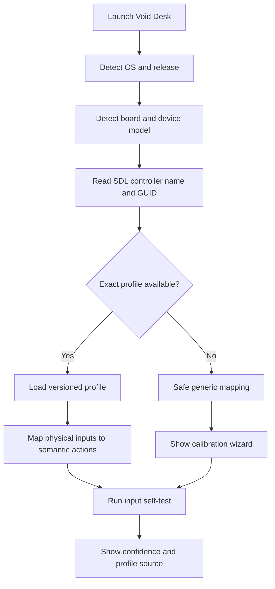

# 🎮 muOS firmware, device and input compatibility

> [!NOTE]
> Compatibility is resolved from **firmware release + device model + controller identity**. “H700” alone is not a sufficiently precise input profile.

## Release matrix

| Firmware line | Official status reviewed 12 Nov 2026 | Void Desk policy |
|---|---|---|
| **2606.0 Andromeda** | Current release listed by muOS | Primary packaging target; exact mapping still requires device/GUID validation |
| **2601.0 Jacaranda** | Archived release | Keep an explicit legacy profile; do not assume Andromeda equivalence |
| **2601.1 Funky Jacaranda** | Archived release variant | Separate metadata until equivalence has been demonstrated |
| **2612 Supernova** | In development; not a stable release | Preview profile only; never mark certified before official release and tests |
| Other / unknown builds | Varies | Safe generic fallback with manual calibration; unsupported until validated |

Official references: [muOS releases](https://muos.dev/release) · [release progress](https://muos.dev/release/progress) · [extending muOS](https://muos.dev/docs/infrastructure/extending).

## Profile resolution

The detector should combine verified firmware markers, kernel/device-tree information, available system metadata and SDL identity. It must report source and confidence for each detected field. Do not document an unverified marker path as a guaranteed API.

## Semantic actions

Frontends consume actions such as `CONFIRM`, `BACK`, `START`, `QUICK_PANEL`, `MEDIA_PANEL`, `VOLUME_UP` and `VOLUME_DOWN`. Device/release profiles map raw SDL or evdev inputs to those stable actions.

| Profile state | Meaning | UI treatment |
|---|---|---|
| Exact / validated | Release + model + controller profile tested | Normal profile label and test metadata |
| Matched / unverified | Candidate profile appears applicable but has no device evidence | Warning; allow test/calibration, do not call certified |
| Generic fallback | No exact profile is available | Safe default and first-run calibration |
| User override | User explicitly selected or edited a mapping | Show override and provide reset/export |

## Calibration and safety

- Never overwrite the active mapping merely because a new release was detected.
- Save profile changes atomically and keep the previous working version for rollback.
- Provide a “restore default mapping” recovery action reachable without a working custom profile.
- Keep profile data declarative; it must not execute scripts.
- Record device model, firmware string, controller name/GUID, profile ID and test outcome in diagnostics. Redact personal identifiers.

## Release monitoring

A release watcher may check the official release page over TLS on a rate-limited schedule and cache the last successful result for offline use. It is informational: it does not download firmware, execute remote code, or silently change controller mappings. New profiles need review, tests and an explicit activation path.
